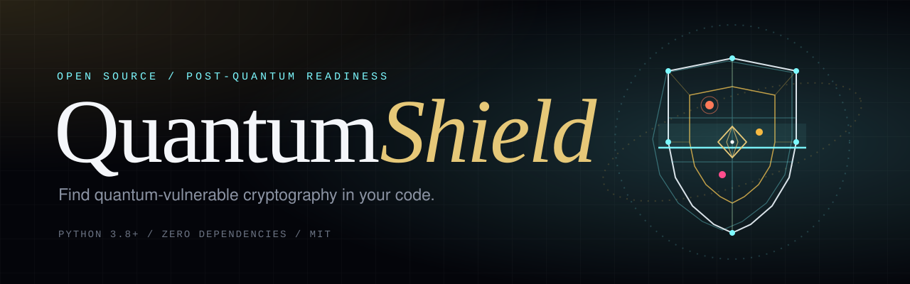
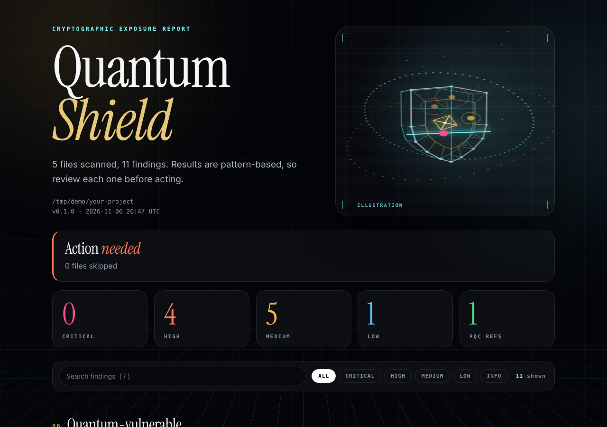

<p align="center">
  
</p>

A small command-line tool that scans source code and configuration files for cryptography that a future quantum computer is expected to break, and for common classical crypto mistakes. It helps teams start a **cryptographic inventory** and plan a migration to the NIST post-quantum standards.

No dependencies. Python 3.8+.

## Why this exists

Attackers can record encrypted traffic today and decrypt it once quantum computers are strong enough ("harvest now, decrypt later"). Before you can migrate, you need to know where RSA, elliptic curves and Diffie-Hellman are used. NIST published the first post-quantum standards in August 2024: FIPS 203 (ML-KEM), FIPS 204 (ML-DSA) and FIPS 205 (SLH-DSA).

## Report preview

The HTML report is a single offline file: animated 3D scan visual, severity filter, search, and expandable fix guidance for every finding. Respects reduced-motion settings.

<p align="center">
  
</p>

A project landing page is in `docs/index.html` (open it locally, or serve it with GitHub Pages: Settings, Pages, branch `main`, folder `/docs`).

## Install and run

```bash
git clone https://github.com/komarapujordanephraim-creator/quantumshield.git
cd quantumshield

python -m quantumshield scan path/to/your/project
python -m quantumshield scan path/to/your/project --html report.html
python -m quantumshield scan path/to/your/project --format json > report.json
```

Optional install as a command:

```bash
pip install -e .
quantumshield scan .
```

## Options

| Option | Meaning |
|---|---|
| `--html FILE` | Write a standalone HTML report |
| `--format json` | Print machine-readable JSON |
| `--exclude NAME` | Skip a directory or relative path (repeatable) |
| `--fail-on LEVEL` | Exit code 1 if a finding at this level or higher exists (`critical`, `high`, `medium`, `low`, `none`). Default `high` |

Exit codes: `0` ok, `1` findings at or above `--fail-on`, `2` usage error.

Suppress a line you have reviewed by adding `quantumshield: ignore` in a comment on that line.

## What it detects (v0.1)

| ID | Finding | Severity | Type |
|---|---|---|---|
| QS001 | RSA usage | high | quantum |
| QS002 | ECC, ECDSA, ECDH, Ed25519, X25519 | high | quantum |
| QS003 | Diffie-Hellman | high | quantum |
| QS004 | DSA | high | quantum |
| QS005 | JWT signing with RS/PS/ES/EdDSA | medium | quantum |
| QS006 | ssh-rsa / ssh-dss keys | medium | quantum |
| QS007 | AES-128 (reduced margin vs Grover) | low | quantum |
| QS008 | MD5 / SHA-1 | medium | classical |
| QS009 | Key size 512/768/1024 | high | classical |
| QS010 | SSLv2/v3, TLS 1.0/1.1 | medium | classical |
| QS011 | Private key committed to source | critical | classical |
| QS100 | Post-quantum algorithm referenced | info | pqc |

Languages and files covered: Python, JavaScript/TypeScript, Java, Kotlin, Go, Ruby, PHP, C#, C/C++, Rust, Swift, shell, YAML, JSON, TOML, INI, Terraform, PEM and common config files.

## Limitations (read this)

- Detection is **pattern-based**, line by line. It does not parse code or follow data flow.
- It can **miss** crypto used through wrappers, dependencies or runtime configuration, and it can **flag** harmless code (for example a string in a comment).
- It does not scan compiled binaries, container images or network traffic.
- A clean result does **not** prove a system is quantum-safe.
- Severity reflects general guidance, not your specific threat model.

## Run the tests

```bash
python -m unittest discover -s tests -t . -v
```

## Roadmap

- [x] v0.1 Pattern scanner, text/JSON/HTML reports, CI exit codes
- [ ] v0.2 Per-language parsing (Python AST) to reduce false positives
- [ ] v0.3 Dependency manifest checks (requirements.txt, package.json)
- [ ] v0.4 SARIF output and a reusable GitHub Action

## Credits and license

MIT. Fonts embedded in the report and landing page: Instrument Serif and Inter, both under the SIL Open Font License 1.1 (see `licenses/`).
